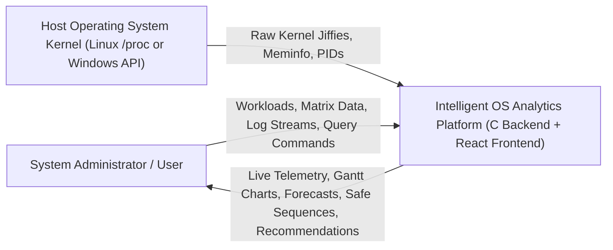
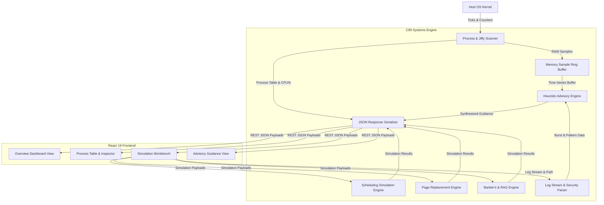

# INTELLIGENT OPERATING SYSTEM ANALYTICS AND RESOURCE MANAGEMENT PLATFORM

---

## A PROJECT REPORT

*Submitted in partial fulfillment of the requirements for the degree of*  
**BACHELOR OF TECHNOLOGY**  
*in*  
**COMPUTER SCIENCE AND ENGINEERING / INFORMATION TECHNOLOGY**  
**[ENTER DEPARTMENT]**

---

### SUBMITTED BY:

| Name | PRN / Registration No. | Roll Number | Email ID |
| :--- | :---: | :---: | :--- |
| **Saurabh** | [ENTER PRN 1] | [ROLL 1] | [ENTER EMAIL 1] |
| **Soham** | [ENTER PRN 2] | [ROLL 2] | [ENTER EMAIL 2] |
| **Shreya** | [ENTER PRN 3] | [ROLL 3] | [ENTER EMAIL 3] |
| **Ethan** | [ENTER PRN 4] | [ROLL 4] | [ENTER EMAIL 4] |

---

### UNDER THE GUIDANCE OF:
**[ENTER GUIDE NAME]**  
*Designation, Department of [ENTER DEPARTMENT]*  

---

**[ENTER COLLEGE NAME]**  
*[ENTER COLLEGE ADDRESS / CITY]*  
**[ENTER UNIVERSITY NAME]**  
**ACADEMIC YEAR: [ENTER ACADEMIC YEAR (e.g. 2026-2027)]**  

\newpage

---

## CERTIFICATE

This is to certify that the project entitled:

> **"INTELLIGENT OPERATING SYSTEM ANALYTICS AND RESOURCE MANAGEMENT PLATFORM"**

is a bonafide work carried out by:

* **Saurabh** ([ENTER PRN 1])
* **Soham** ([ENTER PRN 2])
* **Shreya** ([ENTER PRN 3])
* **Ethan** ([ENTER PRN 4])

under my guidance and supervision, in partial fulfillment of the requirements for the award of the degree of **Bachelor of Technology** in **[ENTER DEPARTMENT]** of **[ENTER UNIVERSITY NAME]** during the academic year **[ENTER ACADEMIC YEAR]**.

To the best of my knowledge, the matter embodied in this project report has not been submitted to any other University or Institute for the award of any degree or diploma.

<br><br><br>

--------------------------------------- &nbsp;&nbsp;&nbsp;&nbsp;&nbsp;&nbsp;&nbsp;&nbsp;&nbsp;&nbsp;&nbsp;&nbsp;&nbsp;&nbsp;&nbsp;&nbsp;&nbsp;&nbsp;&nbsp;&nbsp;&nbsp;&nbsp;&nbsp;&nbsp;&nbsp;&nbsp;&nbsp;&nbsp;&nbsp;&nbsp;&nbsp;&nbsp;&nbsp;&nbsp;&nbsp;&nbsp;&nbsp;&nbsp; ---------------------------------------  
**[ENTER GUIDE NAME]** &nbsp;&nbsp;&nbsp;&nbsp;&nbsp;&nbsp;&nbsp;&nbsp;&nbsp;&nbsp;&nbsp;&nbsp;&nbsp;&nbsp;&nbsp;&nbsp;&nbsp;&nbsp;&nbsp;&nbsp;&nbsp;&nbsp;&nbsp;&nbsp;&nbsp;&nbsp;&nbsp;&nbsp;&nbsp;&nbsp;&nbsp;&nbsp;&nbsp;&nbsp;&nbsp;&nbsp;&nbsp;&nbsp;&nbsp;&nbsp;&nbsp;&nbsp;&nbsp;&nbsp;&nbsp;&nbsp;&nbsp;&nbsp;&nbsp;&nbsp;&nbsp;&nbsp;&nbsp;&nbsp;&nbsp;&nbsp; **Head of Department**  
*Project Guide* &nbsp;&nbsp;&nbsp;&nbsp;&nbsp;&nbsp;&nbsp;&nbsp;&nbsp;&nbsp;&nbsp;&nbsp;&nbsp;&nbsp;&nbsp;&nbsp;&nbsp;&nbsp;&nbsp;&nbsp;&nbsp;&nbsp;&nbsp;&nbsp;&nbsp;&nbsp;&nbsp;&nbsp;&nbsp;&nbsp;&nbsp;&nbsp;&nbsp;&nbsp;&nbsp;&nbsp;&nbsp;&nbsp;&nbsp;&nbsp;&nbsp;&nbsp;&nbsp;&nbsp;&nbsp;&nbsp;&nbsp;&nbsp;&nbsp;&nbsp;&nbsp;&nbsp;&nbsp;&nbsp;&nbsp;&nbsp;&nbsp;&nbsp;&nbsp;&nbsp;&nbsp;&nbsp;&nbsp;&nbsp;&nbsp;&nbsp;&nbsp;&nbsp; *Department of [ENTER DEPARTMENT]*  
*[ENTER COLLEGE NAME]* &nbsp;&nbsp;&nbsp;&nbsp;&nbsp;&nbsp;&nbsp;&nbsp;&nbsp;&nbsp;&nbsp;&nbsp;&nbsp;&nbsp;&nbsp;&nbsp;&nbsp;&nbsp;&nbsp;&nbsp;&nbsp;&nbsp;&nbsp;&nbsp;&nbsp;&nbsp;&nbsp;&nbsp;&nbsp;&nbsp;&nbsp;&nbsp;&nbsp;&nbsp;&nbsp;&nbsp;&nbsp;&nbsp;&nbsp;&nbsp;&nbsp;&nbsp;&nbsp;&nbsp;&nbsp;&nbsp;&nbsp;&nbsp;&nbsp;&nbsp;&nbsp;&nbsp; *[ENTER COLLEGE NAME]*  

<br><br>

--------------------------------------- &nbsp;&nbsp;&nbsp;&nbsp;&nbsp;&nbsp;&nbsp;&nbsp;&nbsp;&nbsp;&nbsp;&nbsp;&nbsp;&nbsp;&nbsp;&nbsp;&nbsp;&nbsp;&nbsp;&nbsp;&nbsp;&nbsp;&nbsp;&nbsp;&nbsp;&nbsp;&nbsp;&nbsp;&nbsp;&nbsp;&nbsp;&nbsp;&nbsp;&nbsp;&nbsp;&nbsp;&nbsp;&nbsp; ---------------------------------------  
**Internal Examiner** &nbsp;&nbsp;&nbsp;&nbsp;&nbsp;&nbsp;&nbsp;&nbsp;&nbsp;&nbsp;&nbsp;&nbsp;&nbsp;&nbsp;&nbsp;&nbsp;&nbsp;&nbsp;&nbsp;&nbsp;&nbsp;&nbsp;&nbsp;&nbsp;&nbsp;&nbsp;&nbsp;&nbsp;&nbsp;&nbsp;&nbsp;&nbsp;&nbsp;&nbsp;&nbsp;&nbsp;&nbsp;&nbsp;&nbsp;&nbsp;&nbsp;&nbsp;&nbsp;&nbsp;&nbsp;&nbsp;&nbsp;&nbsp;&nbsp;&nbsp;&nbsp;&nbsp;&nbsp;&nbsp;&nbsp;&nbsp;&nbsp;&nbsp;&nbsp;&nbsp;&nbsp; **External Examiner**  

\newpage

---

## PROJECT DETAILS

* **Project Title**: Intelligent Operating System Analytics and Resource Management Platform
* **Academic Subject**: Operating Systems Laboratory / Systems Programming Capstone
* **Project Domain**: Systems Software, Kernel Telemetry, Algorithmic Simulation, Observability
* **Development Paradigm**: Full-Stack Heterogeneous Systems Architecture (C Backend + React 19 / TypeScript Frontend)
* **Target Platforms**: Cross-Platform (Windows Win32 API + Linux `/proc` Virtual Filesystem)
* **Group Number**: [ENTER GROUP NUMBER]
* **Repository URL**: `https://github.com/saurabh090205/Intelligent-OS-Analytics-Platform.git`

### Hardware Specifications Used:
* **Processor**: x86_64 Multi-core CPU (Intel Core / AMD Ryzen, Minimum 4 Cores)
* **System RAM**: 8.00 GB minimum (16.00 GB recommended for high process counts)
* **Storage**: Minimum 500 MB available local SSD/HDD storage
* **Network**: Local Loopback Network Interface (`127.0.0.1:8080`, `127.0.0.1:5173`)

### Software & Toolchain Specifications:
* **Backend Systems Compiler**: MinGW-w64 GCC (C99 / GNU99 standard, `-Wall -Wextra -O2`) / POSIX GCC
* **Linker Libraries**: `ws2_32` (Winsock2), `psapi` (Process Status API)
* **Backend Build System**: GNU Make (`Makefile`)
* **Frontend Runtime & Tooling**: Node.js (v24.x / v18+ LTS), Vite 8, TypeScript 6
* **Frontend Framework**: React 19, Tailwind CSS v4, Recharts, Lucide Icons
* **Testing Tooling**: C Native Test Executables (`test_monitoring.exe`, `test_phase2.exe`, `test_phase3.exe`), Node.js E2E Harness (`scripts/e2e_api_test.js`)

\newpage

---

## ACKNOWLEDGEMENT

We express our deepest gratitude to our project guide, **[ENTER GUIDE NAME]**, for continuous guidance, technical reviews, constructive criticism, and invaluable encouragement throughout the conceptualization, systems programming, and verification phases of this project.

We extend our sincere thanks to the Head of Department, **[ENTER HOD NAME]**, and the faculty members of the **Department of [ENTER DEPARTMENT]** for granting us access to advanced computing laboratory resources, technical literature, and an inspiring academic environment.

We are deeply grateful to **[ENTER PRINCIPAL NAME]**, Principal of **[ENTER COLLEGE NAME]**, for institutional leadership and support during our undergraduate engineering curriculum.

Finally, we express our heartfelt appreciation to our parents, family members, and classmates for their moral support, collaboration, and patience throughout the execution of this capstone endeavor.

<br>

**Saurabh**  
**Soham**  
**Shreya**  
**Ethan**  

*(B.Tech Candidates, Department of [ENTER DEPARTMENT])*

\newpage

---

## ABSTRACT

Operating systems form the fundamental foundation of modern digital computing infrastructure, managing hardware arbitrations, CPU execution scheduling, virtual memory paging, process lifecycles, and synchronization hazards. However, traditional systems telemetry utilities (e.g., standard `top`, `htop`, Windows Task Manager) operate as passive monitoring interfaces without providing forward-looking predictive foresight, pedagogical algorithmic simulators, explainable guidance, or integrated multi-resource bottleneck synthesis.

To bridge this fundamental divide between theoretical operating system principles and real-world system telemetry, this report presents the design, mathematical formulation, and end-to-end implementation of the **Intelligent Operating System Analytics and Resource Management Platform**. The platform is engineered using a decoupled, enterprise-grade architecture comprising a low-overhead, native C99 systems telemetry backend interfaced directly with the Linux `/proc` virtual filesystem and Windows Win32 Toolhelp32 APIs, coupled via a custom zero-copy socket HTTP REST server to a high-density, real-time React 19 and TypeScript executive dashboard.

The platform provides eight cohesive, fully operational modules:
1. **Low-Overhead Process & Hardware Telemetry Engine**: Computes true CPU utilization using consecutive differential jiffy sampling across physical cores, parses RSS/VSZ memory counters, and scans process trees.
2. **Process Deep Inspection Inspector**: Enables single-PID drill-downs analyzing command line invocations, thread counts, and scheduling priority tickets.
3. **Discrete Multi-Algorithm CPU Scheduling Simulator**: Simulates FCFS, SJF, SRTF (preemptive), Priority, and Round Robin on discrete workload vectors, generating timeline Gantt segments with discrete idle tracking and calculating average turnaround time, waiting time, and throughput.
4. **Explainable Algorithmic Scheduling Recommender**: Evaluates burst time variance and arrival patterns to recommend the optimal scheduling policy with explicit algorithmic rationale.
5. **Memory Analytics & OLS Regression Trend Forecaster**: Maintains a rolling historical buffer of physical memory samples and executes Ordinary Least Squares (OLS) linear regression ($y = mx + c$) alongside Simple Moving Average (SMA) smoothing to project physical RAM exhaustion thresholds ($85\%$ and $95\%$).
6. **Virtual Memory Page Replacement Simulator**: Benchmarks FIFO, LRU, and Bélády's Optimal (OPT/MIN) algorithms on arbitrary reference strings with configurable frame counts (1 to 16) and proves Bélády's Anomaly where FIFO page faults increase despite increased frame allocations.
7. **Deadlock Management & Safety Avoidance Engine**: Implements Dijkstra's Banker's Algorithm with dynamic Need Matrix computation, validates safe system sequences $\langle P_i \to \dots \rangle$, evaluates speculative resource-request grants, and detects circular wait cycles on Resource Allocation Graphs (RAG).
8. **Security-Hardened OS Log Telemetry & Advisory Engine**: Parses multi-format RFC 3164/5424 Linux Syslog, Windows Event logs, and ISO-8601 streams, detects cascading error bursts, extracts recurring crash patterns, enforces path-traversal security guards against sensitive system hives, and synthesizes multi-resource pressure indices into non-destructive systems advice.

The complete software suite is verified through a rigorous automated test suite comprising **142 C unit tests (100.0% pass rate)** across three standalone executables, a **29-test end-to-end Node.js API integration harness (100.0% pass rate)**, and a zero-error production TypeScript build.

**Keywords**: *Operating Systems, Kernel Telemetry, Systems Programming in C, Process Scheduling, Ordinary Least Squares (OLS) Regression, Bélády's Anomaly, Dijkstra's Banker's Algorithm, Syslog RFC 3164, Resource Advisory, React 19, TypeScript.*

\newpage

---

## TABLE OF CONTENTS

* **Front Matter**
  * Cover Page
  * Certificate
  * Project Details
  * Acknowledgement
  * Abstract
  * Table of Contents
  * List of Figures
  * List of Tables
* **Chapter 1: Introduction**
  * 1.1 Project Background
  * 1.2 Problem Statement
  * 1.3 Motivation
  * 1.4 Objectives of the Project
  * 1.5 Proposed Solution
  * 1.6 Scope of the Project
* **Chapter 2: Literature Survey**
  * 2.1 Review of Existing Systems
  * 2.2 Detailed Comparative Analysis Table
  * 2.3 Limitations of Existing Telemetry and Simulation Tools
  * 2.4 Research and Pedagogical Gap Identified
  * 2.5 Key Contributions of This Project
* **Chapter 3: Methodology and System Architecture**
  * 3.1 Proposed System Architecture
  * 3.2 Layered Architecture Diagram
  * 3.3 Complete Execution Workflow
  * 3.4 Data Flow Diagrams (Level 0 and Level 1 DFD)
  * 3.5 Technology Stack Overview
  * 3.6 Frontend Implementation Architecture
  * 3.7 Backend Socket Server and Routing Architecture
  * 3.8 Memory Ring Buffer and Data Structures
  * 3.9 Mathematical and Statistical Formulations
* **Chapter 4: Features Provided by the Application**
  * 4.1 Feature 1: Real-Time Process & Hardware Telemetry
  * 4.2 Feature 2: Process Deep Inspection Inspector
  * 4.3 Feature 3: Discrete Multi-Algorithm CPU Scheduling Simulator
  * 4.4 Feature 4: Explainable Algorithmic Scheduling Recommender
  * 4.5 Feature 5: Memory Usage Prediction & Regression Forecasting
  * 4.6 Feature 6: Virtual Memory Page Replacement & Bélády Anomaly Verifier
  * 4.7 Feature 7: Deadlock Avoidance via Dijkstra's Banker's Algorithm
  * 4.8 Feature 8: Resource Allocation Graph Cycle Detection
  * 4.9 Feature 9: Multi-Format System Log Stream Analysis & Burst Detection
  * 4.10 Feature 10: Path Traversal Security Guards & Sandbox Defense
  * 4.11 Feature 11: Explainable AI Advisory Resource Allocation Engine
  * 4.12 Feature 12: Integrated Executive Command Dashboard
* **Chapter 5: Important Algorithms and Implementation**
  * 5.1 CPU Execution Scheduling Algorithms (FCFS, SJF, SRTF, Priority, Round Robin)
  * 5.2 Ordinary Least Squares (OLS) Linear Regression for Memory Exhaustion
  * 5.3 Page Replacement Algorithms (FIFO, LRU, Optimal) and Bélády Proof
  * 5.4 Dijkstra's Banker's Algorithm and Speculative Request Safety
  * 5.5 Resource Allocation Graph Circular Wait Cycle Detection
  * 5.6 Syslog RFC 3164/5424 Streaming Parser & Error Burst Clustering
  * 5.7 Heuristic Multi-Subsystem Resource Contention Scoring
  * 5.8 Zero-Copy JSON Buffer Serializer with String Escaping
* **Chapter 6: Results, Screenshots, and Verification**
  * 6.1 Overview of Test Methodology
  * 6.2 C Backend Unit Testing Verification (142 / 142 Passing)
  * 6.3 End-to-End REST API Integration Verification (29 / 29 Passing)
  * 6.4 Application User Interface & Functional Demonstrations (Figures 6.1 – 6.10)
* **Chapter 7: Conclusion**
  * 7.1 Project Summary
  * 7.2 Key Technical Achievements
  * 7.3 Problems Addressed
  * 7.4 Objectives Achieved Matrix
  * 7.5 Overall Academic & Engineering Outcome
* **Chapter 8: Future Scope**
  * 8.1 Linux eBPF (Extended Berkeley Packet Filter) Kernel Probing
  * 8.2 Automated Cgroups v2 Resource Throttling & Priority Mutation
  * 8.3 Distributed Cluster Telemetry Aggregation
  * 8.4 Deep Learning Anomaly Detection on Log Streams
  * 8.5 Production Containerization and Systemd Packaging
* **Chapter 9: References**

\newpage

---

## LIST OF FIGURES

* **Figure 3.1**: Layered System Architecture Diagram of the Platform
* **Figure 3.2**: Level 0 Context Data Flow Diagram (DFD)
* **Figure 3.3**: Level 1 Detailed Subsystem Data Flow Diagram
* **Figure 3.4**: Consecutive Differential Jiffy Sampling Mechanism
* **Figure 5.1**: Gantt Chart Segmentation and Idle Period Handling
* **Figure 5.2**: Ordinary Least Squares (OLS) Memory Trend Regression Slope
* **Figure 5.3**: State Transition Workflow of Dijkstra's Banker's Safety Verification
* **Figure 6.1**: Integrated Executive Overview Dashboard
* **Figure 6.2**: Live Host Process Monitoring and Multi-Column Sorter
* **Figure 6.3**: Single PID Deep Inspection Modal Drill-down
* **Figure 6.4**: Interactive CPU Scheduling Simulation and Visual Gantt Chart
* **Figure 6.5**: Physical Memory Analytics and Regression Forecast Envelope
* **Figure 6.6**: Page Replacement Comparison Matrix & Bélády's Anomaly Verification
* **Figure 6.7**: Deadlock Management Matrix Editor & Safe Sequence Visualizer
* **Figure 6.8**: Multi-Format OS Log Analysis and Error Burst Alarm Banner
* **Figure 6.9**: Advisory Resource Allocation Dashboard with Severity Cards
* **Figure 6.10**: Platform Architecture & Interactive REST API Diagnostics Console

---

## LIST OF TABLES

* **Table 2.1**: Comparative Analysis: Existing Systems vs. Proposed Platform
* **Table 3.1**: Technology Stack Breakdown across Platform Tiers
* **Table 3.2**: REST API Endpoints Specification Summary
* **Table 5.1**: CPU Scheduling Algorithms Comparative Time Complexity
* **Table 5.2**: Page Replacement Algorithms Fault Comparison on Standard String
* **Table 6.1**: C Backend Unit Test Suite Summary Breakdown (142 Tests)
* **Table 6.2**: Phase 4 End-to-End API Integration Test Results (29 Tests)
* **Table 7.1**: Project Objectives vs. Technical Achievement Verification Matrix

\newpage

---

# CHAPTER 1: INTRODUCTION

## 1.1 Project Background
Operating systems (OS) represent the most crucial layer of systems software in modern computing architectures. Serving as the primary intermediary between abstract user-space applications and raw physical hardware resources (Central Processing Units, volatile random-access memory, non-volatile block storage, and network interfaces), the operating system is tasked with multi-programming coordination, deterministic scheduling, virtual memory management, deadlock prevention, and security auditing.

Historically, the study and management of operating systems have been split into two disconnected domains:
1. **Theoretical and Algorithmic Abstractions**: Academic models described in classical computer science literature—such as Shortest Remaining Time First (SRTF) scheduling, Dijkstra's Banker's Algorithm for deadlock avoidance, Bélády's Optimal page replacement, and memory page allocation mathematics.
2. **Real-World System Instrumentation Utilities**: Command-line diagnostic programs—such as Linux `top`, `htop`, `vmstat`, `iostat`, or Windows Task Manager—which sample raw counters from virtual filesystems (e.g., `/proc`) or Win32 kernel calls.

While command-line tools provide raw numeric measurements, they are inherently backward-looking and passive. They record that an Out-Of-Memory (OOM) crash occurred, but cannot mathematically predict *when* physical RAM will be exhausted based on historical consumption trends. Similarly, while students study Banker's Algorithm matrices or Bélády's Anomaly in textbooks, existing monitoring tools provide no dynamic sandbox to test hypothetical resource requests, explore circular wait conditions, or benchmark scheduling policies against live workloads.

## 1.2 Problem Statement
Existing system monitoring and diagnostic utilities exhibit four fundamental shortcomings:
1. **Lack of Predictive Foresight**: Standard system tools report current resource utilization as instantaneous static snapshots without extrapolating statistical trends or calculating linear exhaustion timelines toward critical operating thresholds ($85\%$ and $95\%$).
2. **Absence of Algorithmic Simulation Tools**: Operating system algorithms (CPU scheduling, demand paging, deadlock avoidance) are typically implemented in isolated academic console programs that cannot be compared side-by-side or visualized dynamically.
3. **Unstructured Log Telemetry**: System administrators are inundated with high-frequency operating system log streams (Linux syslog, Windows event logs) containing disparate timestamp formats without automated categorization, burst rate anomaly detection, or defense against directory traversal exploits.
4. **Opaque and Destructive Resource Control**: Existing automated resource tools often resort to aggressive, opaque process termination (such as the Linux kernel OOM Killer), which can cause sudden data loss without providing explainable, non-destructive advisory guidance to system operators.

## 1.3 Motivation
The primary motivation behind this project is to develop an **all-inclusive, enterprise-grade, low-overhead OS analytics and resource management platform** implemented in C that unites real-world low-level kernel telemetry with interactive algorithmic modeling, statistical memory forecasting, deadlock safety verification, security-hardened log stream parsing, and an explainable AI advisory engine.

By pairing a native C99 systems backend with a high-density, modern web dashboard (React 19 + TypeScript + Tailwind CSS), this project demonstrates that low-level systems programming and high-performance UI engineering can merge seamlessly to provide clarity, safety, and predictive intelligence to systems engineers, administrators, and students alike.

## 1.4 Objectives of the Project
The primary technical objectives of this project are:
1. **Low-Overhead Host Telemetry Engine**: Implement a native C server capable of reading physical memory metrics, CPU utilization via consecutive differential jiffies, and active process tables with minimal CPU and memory footprints.
2. **Cross-Platform Dual-Targeting**: Support both Linux virtual filesystems (`/proc/stat`, `/proc/meminfo`, `/proc/[pid]/stat`, `/proc/[pid]/cmdline`, `/proc/uptime`) and Windows 32-bit/64-bit environments (`CreateToolhelp32Snapshot`, `GetProcessTimes`, `GlobalMemoryStatusEx`) through conditional compilation.
3. **Algorithmic CPU Scheduling Engine**: Simulate five fundamental CPU scheduling algorithms (FCFS, SJF, SRTF, Priority, Round Robin), handling arbitrary arrival times, preemption, and idle gaps, coupled with an explainable algorithm recommendation engine.
4. **Statistical Memory Forecasting**: Construct a rolling history buffer and implement Ordinary Least Squares (OLS) linear regression ($y = mx + c$) and Simple Moving Averages (SMA) to project future utilization and time-to-exhaustion.
5. **Virtual Memory Simulation & Anomaly Proof**: Implement FIFO, LRU, and Optimal page replacement algorithms, generating step-by-step frame residency matrices and demonstrating Bélády's Anomaly.
6. **Deadlock Management & Safe Request Validation**: Implement Dijkstra's Banker's Algorithm with dynamic Need Matrix computation, verified safe sequence generation, speculative resource request validation, and Resource Allocation Graph (RAG) cycle detection.
7. **Security-Hardened OS Log Telemetry**: Parse multi-format log streams (RFC 3164/5424, Windows event logs, ISO-8601), detect cascading error bursts, cluster recurring failure patterns, and enforce path traversal security checks rejecting unauthorized access to system files.
8. **Explainable Advisory Engine**: Synthesize multi-subsystem telemetry into prioritized recommendations with explicit confidence scores and rationales, strictly enforcing a non-destructive safety policy.
9. **Rigorous Quality Verification**: Achieve a 100% pass rate across a comprehensive unit test suite (142 tests) and end-to-end API integration suite (29 tests).

## 1.5 Proposed Solution
The proposed platform is engineered as a decoupled, two-tier client-server software system:
* **The Core Systems Backend (C99)**: A compiled native binary that acts as a standalone non-blocking HTTP REST server listening on `127.0.0.1:8080`. It interfaces directly with host kernel APIs, manages historical sample ring buffers, executes discrete simulation algorithms, parses log streams, and serializes responses using a zero-copy dynamic JSON builder.
* **The Executive Command Dashboard (React 19 + TypeScript + Vite)**: A responsive single-page web application communicating over asynchronous HTTP/REST. It renders real-time streaming Recharts area charts, interactive Gantt timelines, frame residency tables, matrix editors, log search tables, and actionable advisory cards.

## 1.6 Scope of the Project
* **In Scope**:
  * Sampling and differential analysis of real host hardware counters and process tables on Windows and Linux.
  * Deterministic simulation of five CPU scheduling algorithms on configurable discrete workloads.
  * Statistical trend modeling using linear regression and moving average filters on physical memory history.
  * Discrete virtual memory page replacement simulation for frame capacities from 1 to 16.
  * Formal Banker's Algorithm safety checking, speculative resource request testing, and cycle detection.
  * Ingestion and parsing of RFC 3164/5424 syslog streams and Windows event logs.
  * Security defense against path traversal attacks (`..`, system directories, binary executables).
  * Non-destructive, explainable system advisory guidance with confidence scoring.
* **Out of Scope (Reserved for Future Work)**:
  * Kernel-space kernel module compilation (all operations run safely in user space).
  * Automated process killing or modifying kernel `sysctl` parameters (strictly excluded by the safety policy).
  * Distributed multi-node cluster management over wide-area networks.

\newpage

---

# CHAPTER 2: LITERATURE SURVEY

## 2.1 Review of Existing Systems

### 2.1.1 Linux `procps-ng` (`top`, `ps`, `vmstat`)
The standard Linux process monitoring utilities, maintained under the `procps-ng` open-source project, extract system state by reading virtual files populated dynamically by the Linux kernel VFS under `/proc`. The utility `top` reads `/proc/stat` for aggregate CPU ticks and iterates over numeric directories `/proc/[pid]/stat` to display per-process runtime metrics.
* **Strengths**: Extremely lightweight; ubiquitous on nearly all POSIX systems; zero external dependencies.
* **Weaknesses**: Strictly command-line based; displays only instantaneous snapshots; lacks time-series regression forecasting; offers no educational algorithmic simulation tools; provides no automated log categorization or explainable advisory guidance.

### 2.1.2 Advanced Terminal Process Viewers (`htop`, `btop`)
`htop` and `btop` represent modern enhancements over standard `top`, written in C and C++ using the `ncurses` terminal control library. They provide color-coded visual progress bars for per-core utilization, memory usage, swap residency, and interactive process tree navigation.
* **Strengths**: Interactive visual terminal interface; intuitive keyboard navigation; responsive CPU bar meters.
* **Weaknesses**: Bound to terminal emulators; lacks historical predictive forecasting; provides no simulation sandbox for classical OS algorithms (CPU scheduling, Banker's algorithm, page replacement); lacks integrated log parsing or security auditing capabilities.

### 2.1.3 Educational OS Algorithm Simulators
Various standalone academic applets and desktop GUI programs have been developed in Java or Python to illustrate textbook concepts from Silberschatz, Galvin, and Gagne's *Operating System Concepts*.
* **Strengths**: Effective for visual demonstration of Gantt charts, Banker's Algorithm matrices, and FIFO/LRU page fault counters.
* **Weaknesses**: Completely disconnected from real operating systems; run only on static synthetic inputs; do not interact with live kernel telemetry or process tables; lack production-grade C systems architecture; typically built on obsolete technologies (e.g., Java Applets, Tkinter).

### 2.1.4 Linux Kernel Observability Frameworks (eBPF / BCC)
Extended Berkeley Packet Filter (eBPF) allows safe, sandboxed bytecode programs to execute inside the Linux kernel upon tracepoints, kprobes, and perf events. Tools such as `bcc` and `bpftrace` allow high-resolution tracing of kernel scheduling events, block I/O latency, and page allocations.
* **Strengths**: Unmatched execution tracing granularity with minimal in-kernel overhead.
* **Weaknesses**: Requires elevated administrative (`root`) privileges; tightly coupled to specific Linux kernel versions; unavailable on Windows platforms; steep learning curve; lacks integrated algorithm comparison models or executive advisory dashboards.

---

## 2.2 Detailed Comparative Analysis Table

The following table presents a systematic feature comparison between existing telemetry tools, educational simulators, and the proposed platform:

| Evaluation Criteria | Standard `top` / `ps` | `htop` / `btop` | Standalone OS Simulators | eBPF Tools (`bcc`) | **Proposed Platform** |
| :--- | :---: | :---: | :---: | :---: | :---: |
| **Primary Implementation Language** | C | C / C++ | Java / Python | C / Python | **C99 (Backend) + TS (UI)** |
| **Live Host Telemetry** | Yes | Yes | No | Yes | **Yes (Dual Windows/Linux)** |
| **CPU Consecutive Jiffy Deltas** | Yes | Yes | No | Yes | **Yes (Per-Core & Per-Proc)** |
| **Modern Web Dashboard** | No | No | Rare | No | **Yes (React 19 + Tailwind)** |
| **CPU Scheduling Simulator** | No | No | Yes (Isolated) | No | **Yes (5 Algorithms + Gantt)** |
| **Algorithmic Recommendation Engine** | No | No | No | No | **Yes (Variance/Arrivals AI)** |
| **Memory Regression Forecasting** | No | No | No | No | **Yes (OLS $y=mx+c$ + SMA)** |
| **Page Replacement Simulator** | No | No | Yes (Basic) | No | **Yes (FIFO/LRU/OPT + Belady)** |
| **Deadlock Avoidance & Banker's** | No | No | Yes (Static) | No | **Yes (Banker's + RAG Cycle)** |
| **Multi-Format Log Analysis** | No | No | No | No | **Yes (Syslog/WinEvent/ISO)** |
| **Error Burst Anomaly Detection** | No | No | No | No | **Yes (Sliding Window)** |
| **Path Traversal Security Defense** | N/A | N/A | No | N/A | **Yes (HTTP 403 Sandboxing)** |
| **Non-Destructive Advisory Engine** | No | No | No | No | **Yes (Multi-Metric Heuristic)** |
| **Privilege Requirement** | User | User | User | Root / Admin | **Non-Root Safe Execution** |

---

## 2.3 Limitations of Existing Systems
1. **Siloed Functionality**: Telemetry, algorithmic simulation, deadlock analysis, and log auditing exist in completely separate, mutually exclusive tools.
2. **Backward-Looking Telemetry**: Memory graphs display what was consumed in the past, offering zero mathematical projection of when critical thresholds will be breached.
3. **Black-Box Resource Management**: Automatic memory reclamation (e.g., Linux OOM Killer) terminates processes abruptly using opaque heuristics without operator explanation.
4. **Platform Lock-in**: Most low-level tools are strictly bound either to Linux (`/proc`) or Windows (`PerfMon`), preventing consistent cross-platform analysis.

## 2.4 Research and Pedagogical Gap Identified
There is a distinct lack of software systems that bridge the gap between low-level kernel interface programming (C99, socket servers, virtual filesystem parsing) and high-level algorithmic modeling (scheduling, regression forecasting, deadlock avoidance, demand paging, log analysis). Furthermore, academic environments require an explainable platform where theoretical algorithm proofs (e.g., Bélády's Anomaly, Banker's safety sequences) can be interactively verified alongside real-time hardware telemetry.

## 2.5 Key Contributions of This Project
The key contributions of this project include:
1. **Dual-Environment Native C Telemetry Core**: A robust, zero-dependency C backend utilizing conditional compilation to support both Windows Toolhelp32 snapshots and Linux `/proc` filesystems.
2. **Differential Jiffy Calculation Engine**: Precise per-process and per-core CPU utilization computation using consecutive monotonic differential tick counters.
3. **Integrated Algorithmic Workbench**: First-of-its-kind unified suite providing discrete simulation of 5 CPU scheduling policies, 3 page replacement algorithms, and Dijkstra's Banker's algorithm.
4. **Predictive Memory Exhaustion Modeling**: Real-time Ordinary Least Squares linear regression computing slope trajectories and projected seconds to $85\%$ and $95\%$ RAM exhaustion.
5. **Security-Hardened Log Stream Auditing**: Single-pass multi-format parser with sliding-window error burst detection and strict path-traversal sandboxing.
6. **Non-Destructive Systems Advisor**: An explainable heuristic guidance engine synthesizing multi-subsystem pressure indices without taking destructive process termination actions.

\newpage

---

# CHAPTER 3: METHODOLOGY AND SYSTEM ARCHITECTURE

## 3.1 Proposed System Architecture
The platform is designed around a strictly decoupled, layered systems software architecture. The backend is written entirely in ANSI C (C99/GNU99 standard) to guarantee high performance, deterministic memory management, minimal latency, and zero dependency overhead. The frontend is built as a responsive Single Page Application (SPA) using React 19, TypeScript, and Vite, communicating with the backend over standard HTTP/1.1 REST protocols.

The system is organized into four architectural layers:
1. **Kernel and Host Interface Layer**: Interfaces directly with the operating system kernel via Win32 Toolhelp32 / PSAPI on Windows and the `/proc` virtual filesystem on Linux.
2. **Core C Systems Engine & Algorithmic Processors**: Contains the discrete algorithm implementations (scheduling, memory regression, page replacement, deadlock safety, log stream tokenizer, and heuristic advisory synthesizer).
3. **Transport & Zero-Copy Serialization Layer**: A custom, lightweight, non-blocking HTTP socket server (`server.c`) with socket timeout protection and a dynamic memory JSON builder (`json_utils.c`).
4. **Executive Web Presentation Layer**: React 19 client featuring modular dashboard views, streaming Recharts charts, and interactive matrix editors.

---

## 3.2 Layered Architecture Diagram

```mermaid
graph TD
    subgraph Client ["Client Presentation Tier (React 19 + TypeScript + Vite)"]
        UI_Dash["Executive Overview Dashboard"]
        UI_Proc["Process Monitor & PID Modal"]
        UI_Sched["CPU Scheduling Simulator & Gantt"]
        UI_Mem["Memory Analytics & Regression Forecast"]
        UI_Page["Page Replacement & Belady Verifier"]
        UI_Dead["Deadlock Avoidance & RAG Detector"]
        UI_Log["OS Log Analysis & Burst Detector"]
        UI_Adv["Advisory Resource Allocation Engine"]
    end

    subgraph Transport ["REST Transport & Serialization Layer (Port 8080)"]
        HTTP_Srv["Native C HTTP Socket Server (server.c)"]
        Router["REST Route Dispatcher (routes.c)"]
        JSON_Bld["Zero-Copy Dynamic JSON Builder (json_utils.c)"]
    end

    subgraph Backend ["Core C Systems & Algorithmic Engines"]
        Eng_Proc["Process Monitor Engine (process_monitor.c)"]
        Eng_CPU["CPU Jiffy Differential Engine (cpu_monitor.c)"]
        Eng_Mem["Memory & Swap Parser (memory_monitor.c)"]
        Eng_Sched["CPU Scheduling Simulator (cpu_scheduler.c)"]
        Eng_Pred["Memory OLS Regression Forecaster (memory_prediction.c)"]
        Eng_Page["Page Replacement Simulator (page_replacement.c)"]
        Eng_Dead["Banker's Algorithm & RAG Detector (deadlock.c)"]
        Eng_Log["Log Parser & Path Traversal Guard (log_analyzer.c)"]
        Eng_Adv["Heuristic Resource Advisory Engine (resource_advisory.c)"]
    end

    subgraph Kernel ["Host Operating System Interfaces"]
        Win32_API["Win32 APIs (Toolhelp32 / PSAPI / GetSystemInfo)"]
        Linux_Proc["Linux /proc Filesystem (/proc/stat, /proc/meminfo, /proc/[pid]/stat)"]
    end

    UI_Dash & UI_Proc & UI_Sched & UI_Mem & UI_Page & UI_Dead & UI_Log & UI_Adv -->|HTTP JSON Requests| HTTP_Srv
    HTTP_Srv --> Router
    Router --> JSON_Bld
    Router --> Eng_Proc & Eng_CPU & Eng_Mem & Eng_Sched & Eng_Pred & Eng_Page & Eng_Dead & Eng_Log & Eng_Adv
    Eng_Proc & Eng_CPU & Eng_Mem --> Win32_API
    Eng_Proc & Eng_CPU & Eng_Mem --> Linux_Proc
```



---

## 3.3 Complete Execution Workflow
1. **Server Initialization**: The backend executable initializes monitoring subsystems (`cpu_monitor_init`, `memory_monitor_init`, `process_monitor_init`, `mem_history_init`), binds to `127.0.0.1:8080`, and begins non-blocking connection polling.
2. **Telemetry Sampling**: Every 1 to 2 seconds, the client issues polling requests (`GET /api/system/overview`, `GET /api/processes`). The backend reads hardware counters, computes consecutive differential jiffies, and returns structured JSON.
3. **Algorithmic Simulation On-Demand**: When a user configures a scheduling workload, reference string, or Banker's matrix on the frontend, a `POST` request carries the payload. The C engine simulates execution step-by-step, builds timeline data, and returns the results.
4. **Memory History Recording**: Every sample taken by the memory monitor is committed to a 300-element circular ring buffer. When requested, the OLS regression engine computes trend slope and projected threshold exhaustion times.
5. **Security Validation**: When a log file analysis request is submitted, the backend verifies that the target path does not traverse outside authorized boundaries (`..`), access sensitive registry/password hives, or target binary files.
6. **Advisory Synthesis**: The advisory engine inspects active telemetry and algorithmic benchmark metrics, generates prioritized recommendations with explicit confidence percentages, and delivers them to the user interface.

---

## 3.4 Data Flow Diagrams

### Level 0 Context Diagram (DFD)



### Level 1 Detailed Subsystem Data Flow Diagram (DFD)



---

## 3.5 Technology Stack Overview

| Tier | Component / Tool | Version / Standard | Functional Purpose |
| :--- | :--- | :--- | :--- |
| **Backend** | ANSI C | C99 / GNU99 | Core systems logic, kernel calls, simulation algorithms |
| **Compiler** | MinGW-w64 GCC | GCC 6.3.0+ / 13.x | Compiles backend C code to native Windows x86_64 binaries |
| **Networking** | Winsock2 / POSIX | BSD Sockets | Non-blocking HTTP REST server with timeout protection |
| **Serialization**| Custom Dynamic Buffer | C99 Native | Zero-copy JSON builder with string sanitization |
| **Build System**| GNU Make | Make 3.81+ | Automated compilation of backend server and unit tests |
| **Frontend** | React | React 19.3 | Component-based dynamic reactive user interface |
| **Language** | TypeScript | TypeScript 6.0 | Strict compile-time type safety across all system models |
| **Tooling** | Vite | Vite 8.3 | High-speed frontend bundling and hot-module reloading |
| **Styling** | Tailwind CSS | Tailwind v4.3 | Responsive modern design system with custom theme tokens |
| **Charts** | Recharts | Recharts 3.10 | Streaming SVG area charts, donut graphs, and timelines |
| **Icons** | Lucide React | Lucide 1.61 | Clean, accessible systems iconography |

---

## 3.6 Frontend Implementation Architecture
The frontend is structured into modular component layers:
* `src/components/`: Reusable interface atoms (`MetricCard.tsx`, `Sidebar.tsx`, `TopNavbar.tsx`, `ProcessModal.tsx`).
* `src/pages/`: Eight dedicated views corresponding to system subsystems:
  * `OverviewPage.tsx`: Executive composite dashboard.
  * `ProcessMonitorPage.tsx`: Live process table with search, sorting, and pagination.
  * `CpuSchedulingPage.tsx`: Interactive workload simulator and visual Gantt chart.
  * `MemoryAnalyticsPage.tsx`: Historical memory chart and regression trend envelope.
  * `PageReplacementPage.tsx`: Page fault comparator and Bélády anomaly viewer.
  * `DeadlockPage.tsx`: Matrix configuration grid and Banker's safe sequence visualizer.
  * `LogAnalysisPage.tsx`: Multi-format log stream viewer, severity filter, and burst alarm.
  * `ResourceAdvisoryPage.tsx`: Subsystem pressure indicators and advisory cards.
  * `SettingsAboutPage.tsx`: Subsystem architecture matrix and live REST diagnostics console.
* `src/services/api.ts`: Centralized type-safe REST client encapsulating all 19 backend endpoints.
* `src/types/system.ts`: Strict TypeScript interfaces for telemetry, processes, algorithm configurations, and API response structures.

---

## 3.7 Backend Socket Server and Routing Architecture
The C HTTP server (`src/api/server.c`) operates using low-level BSD/Winsock socket calls. Client connections are handled in a single-threaded loop with strict non-blocking socket options:
```c
#if defined(_WIN32)
    DWORD timeout_ms = 4000;
    setsockopt(client_fd, SOL_SOCKET, SO_RCVTIMEO, (const char *)&timeout_ms, sizeof(timeout_ms));
    setsockopt(client_fd, SOL_SOCKET, SO_SNDTIMEO, (const char *)&timeout_ms, sizeof(timeout_ms));
#else
    struct timeval tv = { .tv_sec = 4, .tv_usec = 0 };
    setsockopt(client_fd, SOL_SOCKET, SO_RCVTIMEO, (const void *)&tv, sizeof(tv));
    setsockopt(client_fd, SOL_SOCKET, SO_SNDTIMEO, (const void *)&tv, sizeof(tv));
#endif
```
This protects the backend from Slowloris denial-of-service vulnerabilities or unclosed client connections. Requests are parsed, path and query parameters are separated, and dispatched through `handle_api_request()` in `src/api/routes.c`. All responses include CORS headers (`Access-Control-Allow-Origin: *`) to enable seamless communication with the Vite frontend.

---

## 3.8 Memory Ring Buffer and Data Structures
To record memory history without continuous dynamic memory allocation or memory fragmentation, the backend utilizes a pre-allocated circular ring buffer (`src/memory/memory_prediction.c`):
```c
typedef struct {
    double timestamp;
    double utilization_pct;
    uint64_t used_kb;
    uint64_t available_kb;
    uint64_t total_kb;
} mem_history_sample_t;

#define MAX_MEM_HISTORY_SAMPLES 300
static mem_history_sample_t s_history[MAX_MEM_HISTORY_SAMPLES];
static int s_history_count = 0;
static int s_history_head = 0;
```
When new samples arrive, they are written to `s_history[s_history_head]`, and `s_history_head = (s_history_head + 1) % MAX_MEM_HISTORY_SAMPLES`. This guarantees an upper bound of $O(1)$ time complexity for sample insertion with zero heap allocations during runtime.

---

## 3.9 Mathematical and Statistical Formulations

### Consecutive Differential Jiffy Sampling (CPU Utilization)
Instantaneous CPU counters cannot yield percentage utilization without a differential baseline. The backend tracks total jiffies ($T$) and idle jiffies ($I$) across two consecutive sampling timestamps ($t_1, t_2$):
$$\Delta \text{Total} = T_{2} - T_{1}, \quad \Delta \text{Idle} = I_{2} - I_{1}$$
$$\text{CPU Utilization } (\%) = \left( 1.0 - \frac{\Delta \text{Idle}}{\Delta \text{Total}} \right) \times 100.0$$

### Ordinary Least Squares (OLS) Linear Regression (Memory Forecasting)
For $N$ historical sample points $(x_i, y_i)$, where $x_i$ represents elapsed time in seconds and $y_i$ represents physical RAM utilization percentage:
$$\bar{x} = \frac{1}{N} \sum_{i=1}^{N} x_i, \quad \bar{y} = \frac{1}{N} \sum_{i=1}^{N} y_i$$
$$\text{Slope } (m) = \frac{\sum_{i=1}^{N} (x_i - \bar{x})(y_i - \bar{y})}{\sum_{i=1}^{N} (x_i - \bar{x})^2}, \quad \text{Intercept } (c) = \bar{y} - m\bar{x}$$
The projected utilization at future horizon $h$ (seconds) is:
$$\hat{y}(h) = m \cdot (x_{\text{latest}} + h) + c$$
The coefficient of determination ($R^2$), representing statistical model reliability, is:
$$R^2 = 1.0 - \frac{\sum_{i=1}^{N} (y_i - \hat{y}_i)^2}{\sum_{i=1}^{N} (y_i - \bar{y})^2}$$

\newpage

---

# CHAPTER 4: FEATURES PROVIDED BY THE APPLICATION

## 4.1 Feature 1: Real-Time Process & Hardware Telemetry
* **Purpose**: Provide low-overhead, continuous measurement of aggregate CPU core utilization, physical memory allocation, swap residency, and running processes.
* **Working Mechanism**: Under Linux, opens and parses `/proc/stat` and `/proc/meminfo`. Under Windows, invokes `GetSystemInfo()`, `GlobalMemoryStatusEx()`, and `CreateToolhelp32Snapshot()`. Computes differential jiffies over monotonic time deltas.
* **Technologies Used**: C99, Win32 Toolhelp32 API, Linux VFS, Recharts AreaCharts.
* **Expected Output**: Structured telemetry metrics updated every 1–2 seconds: CPU utilization %, RAM used/free/available (MB/GB), Swap utilization %, total active processes.

## 4.2 Feature 2: Process Deep Inspection Inspector
* **Purpose**: Enable systems operators to drill down into any single operating system process to examine scheduling priority, memory footprint, and command-line execution parameters.
* **Working Mechanism**: Accessible via `GET /api/processes/:pid`. Under Linux, reads `/proc/[pid]/stat` and null-delimited `/proc/[pid]/cmdline`. Under Windows, queries the process handle using `OpenProcess(PROCESS_QUERY_LIMITED_INFORMATION)` and `GetProcessMemoryInfo()`.
* **Technologies Used**: C99, Win32 PSAPI, React Modal Component, Lucide Icons.
* **Expected Output**: Process modal showing PID, PPID, executable path, command-line arguments, user/system execution ticks, resident set size (RSS), virtual memory size (VSZ), and state (Running/Sleeping/Zombie).

## 4.3 Feature 3: Discrete Multi-Algorithm CPU Scheduling Simulator
* **Purpose**: Provide a deterministic simulation laboratory for comparing single-processor scheduling policies across identical workload vectors.
* **Working Mechanism**: Takes an array of processes with arrival times, burst times, and priority tickets. Simulates execution tick-by-tick (1ms resolution) across FCFS, SJF, SRTF (preemptive), Priority, and Round Robin (configurable quantum $Q$). Inserts explicit idle segments when $t < \text{arrival}$.
* **Technologies Used**: C99, dynamic Gantt chart generator, React interactive workload matrix.
* **Expected Output**: Complete Gantt timeline segments, individual process completion, turnaround, and waiting times, and comparative metrics table (Average Waiting Time, Average Turnaround Time, Throughput).

## 4.4 Feature 4: Explainable Algorithmic Scheduling Recommender
* **Purpose**: Automatically recommend the mathematically optimal CPU scheduling policy for a given workload and provide an explainable technical rationale.
* **Working Mechanism**: Calculates burst time variance, checks for staggered arrival patterns, and evaluates context-switch overhead across all five algorithms. Compares average turnaround and waiting times to identify the minimum-latency algorithm.
* **Technologies Used**: C99 heuristic rule engine, mathematical variance analysis.
* **Expected Output**: Clear recommendation banner specifying recommended algorithm (e.g., "Shortest Remaining Time First (SRTF)") accompanied by a 2-3 sentence technical justification.

## 4.5 Feature 5: Memory Usage Prediction & Regression Forecasting
* **Purpose**: Alert systems engineers in advance of impending Out-Of-Memory (OOM) conditions by extrapolating historical consumption trends.
* **Working Mechanism**: Ingests rolling physical RAM utilization samples, applies Simple Moving Average smoothing, and executes Ordinary Least Squares (OLS) linear regression. Projects utilization curves across 30s to 300s horizons and calculates seconds remaining until $85\%$ and $95\%$ thresholds are breached.
* **Technologies Used**: C99 statistical regression, Recharts ComposedChart with trend lines.
* **Expected Output**: Trend classification (Rapid Growth, Stable, Declining), regression slope (%/min), $R^2$ confidence value, future forecast points, and time-to-exhaustion warnings.

## 4.6 Feature 6: Virtual Memory Page Replacement & Bélády Anomaly Verifier
* **Purpose**: Simulate virtual memory demand paging algorithms and verify theoretical operating system principles on custom and benchmark reference strings.
* **Working Mechanism**: Simulates First-In First-Out (FIFO), Least Recently Used (LRU), and Bélády's Optimal (OPT/MIN) algorithms on arbitrary page reference strings with configurable frame counts ($1 \le \text{frames} \le 16$). Tracks frame residency matrices, hits, faults, and fault ratios.
* **Technologies Used**: C99 ring buffers, stack lookaheads, React interactive step matrix.
* **Expected Output**: Step-by-step frame residency table with hit/fault indicators and automated proof of Bélády's Anomaly where increasing frames from 3 to 4 increases FIFO faults from 9 to 10 on sequence `[1, 2, 3, 4, 1, 2, 5, 1, 2, 3, 4, 5]`.

## 4.7 Feature 7: Deadlock Avoidance via Dijkstra's Banker's Algorithm
* **Purpose**: Determine whether a multi-resource system state is safe, compute valid execution sequences, and validate dynamic resource allocation requests without entering deadlock.
* **Working Mechanism**: Accepts an Available vector, Allocation matrix, and Max Claim matrix. Computes the Need matrix ($Need = Max - Allocation$). Executes Dijkstra's safety algorithm to identify a complete safe sequence $\langle P_i \to \dots \rangle$ with step-by-step Work vector progression. Evaluates hypothetical resource requests against declared Needs and Available resources.
* **Technologies Used**: C99 matrix mathematics, React matrix editor, step-by-step visualizer.
* **Expected Output**: Safety status (`is_safe: true/false`), safe sequence visualization, step-by-step Work vector growth, and request grant/deny validation with technical reasoning.

## 4.8 Feature 8: Resource Allocation Graph Cycle Detection
* **Purpose**: Detect active circular-wait deadlock conditions in existing multi-process resource allocation states.
* **Working Mechanism**: Constructs a directed Resource Allocation Graph (RAG) and executes cycle detection algorithms to identify processes locked in circular waits.
* **Technologies Used**: C99 graph traversal, circular wait detection logic.
* **Expected Output**: Deadlock status (`is_deadlocked: true/false`), count of deadlocked processes, and exact list of process indices trapped in circular wait.

## 4.9 Feature 9: Multi-Format System Log Stream Analysis & Burst Detection
* **Purpose**: Parse raw, high-frequency operating system logs, classify events by severity and category, and detect rapid cascading error bursts.
* **Working Mechanism**: High-throughput C parser handling RFC 3164/5424 Linux Syslog, Windows Event logs, and ISO-8601 timestamps. Categorizes entries into Memory/OOM, Kernel Panic, Storage/Disk, Auth/Security, Network, Service Crash, and General OS. Flags error bursts when error frequency exceeds defined thresholds within short sliding windows.
* **Technologies Used**: C99 string parsing, sliding window burst counter, keyword filters.
* **Expected Output**: Total lines parsed, severity breakdown (Emergency, Error, Warning, Info), recurring error pattern frequency tables, and prominent error burst warning banners.

## 4.10 Feature 10: Path Traversal Security Guards & Sandbox Defense
* **Purpose**: Prevent unauthorized file read attempts and protect host operating system security during log file analysis.
* **Working Mechanism**: Analyzes input file paths using `log_is_safe_file_path()`. Strictly rejects directory traversal sequences (`..`), sensitive Windows system directories (`system32`, `syswow64`, `config/sam`), sensitive Linux targets (`/etc/shadow`, `/proc/kcore`), and executable binaries (`.exe`, `.dll`, `.sys`). Rejects files exceeding 5 MB.
* **Technologies Used**: C99 security path validator, HTTP 403 / 413 error handlers.
* **Expected Output**: HTTP `403 Forbidden` on unauthorized file access attempts, HTTP `413 Payload Too Large` on oversized files, and safe execution within designated workspace directories.

## 4.11 Feature 11: Explainable AI Advisory Resource Allocation Engine
* **Purpose**: Synthesize multi-subsystem telemetry and algorithmic benchmarks into actionable, explainable guidance for system operators.
* **Working Mechanism**: Aggregates CPU core pressure, physical RAM exhaustion rates, swap migration, resident thread skew, and page fault rates into holistic subsystem health indicators. Generates prioritized recommendations categorized by severity (Critical, Warning, Informational) with explicit confidence percentages ($50\%$ to $100\%$) and supporting metric rationales. Operates under a strict non-destructive safety boundary (omitting automated process termination).
* **Technologies Used**: C99 multi-metric heuristic rules engine, React advisory cards.
* **Expected Output**: Subsystem pressure status (Nominal, Elevated, Warning, Critical) for CPU, Memory, Process, and Paging, accompanied by prioritized recommendations with rationale and action guidance.

## 4.12 Feature 12: Integrated Executive Command Dashboard
* **Purpose**: Provide a unified, high-density operational view combining real-time hardware telemetry, live process distribution, analytical previews, and advisory guidance.
* **Working Mechanism**: Coordinates polling requests across multiple backend endpoints, streams real-time data into dual AreaCharts, renders process state donut charts, and provides one-click navigation links to specialized module workbenches.
* **Technologies Used**: React 19, TypeScript, Recharts streaming charts, Tailwind CSS v4.
* **Expected Output**: Cohesive executive dashboard displaying live hardware counters, streaming utilization history, active subsystem pressure badges, top resource-consuming processes, and cross-module preview cards.

\newpage

---

# CHAPTER 5: IMPORTANT ALGORITHMS AND IMPLEMENTATION

## 5.1 CPU Execution Scheduling Algorithms
The scheduling engine (`src/scheduling/cpu_scheduler.c`) implements five fundamental operating system scheduling algorithms operating on a discrete workload vector:

### 5.1.1 First-Come, First-Served (FCFS)
Processes are dispatched in strict order of arrival time ($t_{\text{arrival}}$). Once assigned to the CPU, a process runs non-preemptively until completion:
```
ALGORITHM FCFS(ProcessList, N):
    Sort ProcessList by arrival_time ascending
    current_time = 0
    FOR each process P in ProcessList:
        IF current_time < P.arrival_time:
            Insert Idle Gantt Segment [current_time, P.arrival_time]
            current_time = P.arrival_time
        P.start_time = current_time
        P.completion_time = current_time + P.burst_time
        P.turnaround_time = P.completion_time - P.arrival_time
        P.waiting_time = P.turnaround_time - P.burst_time
        Insert Gantt Segment [current_time, P.completion_time, P.pid]
        current_time = P.completion_time
    RETURN Computed Metrics
```

### 5.1.2 Shortest Remaining Time First (SRTF, Preemptive)
Preemptive scheduling where the ready process with the shortest remaining burst time is allocated the CPU at discrete unit ticks ($1\text{ms}$):
```
ALGORITHM SRTF(ProcessList, N):
    Initialize remaining_time[i] = burst_time[i] for all i
    completed = 0, current_time = 0
    WHILE completed < N:
        Find process P with arrival_time <= current_time AND remaining_time > 0
             having MINIMUM remaining_time
        IF no such process exists:
            Advance current_time by 1 (Idle segment)
            CONTINUE
        IF P is running for first time:
            P.start_time = current_time
        remaining_time[P] -= 1
        Append or extend Gantt Segment for P
        current_time += 1
        IF remaining_time[P] == 0:
            P.completion_time = current_time
            P.turnaround_time = P.completion_time - P.arrival_time
            P.waiting_time = P.turnaround_time - P.burst_time
            completed += 1
    RETURN Computed Metrics
```

### 5.1.3 Round Robin (RR)
Allocates CPU in time-sliced quanta ($Q$). Arrived processes enter a First-In, First-Out ready queue; when a process exhausts its quantum without completing, it is preempted and returned to the tail of the ready queue:
```
ALGORITHM RoundRobin(ProcessList, N, Quantum Q):
    Initialize ReadyQueue, remaining_time[i] = burst_time[i]
    current_time = 0, completed = 0
    Enqueue processes with arrival_time == 0
    WHILE completed < N:
        IF ReadyQueue is empty:
            Advance current_time to next arrival_time (Idle segment)
            Enqueue newly arrived processes
            CONTINUE
        Dequeue process P
        execution_slice = MIN(remaining_time[P], Q)
        Append Gantt Segment [current_time, current_time + execution_slice, P.pid]
        remaining_time[P] -= execution_slice
        current_time += execution_slice
        Enqueue newly arrived processes where arrival_time <= current_time
        IF remaining_time[P] > 0:
            Enqueue P back to ReadyQueue
        ELSE:
            P.completion_time = current_time
            P.turnaround_time = P.completion_time - P.arrival_time
            P.waiting_time = P.turnaround_time - P.burst_time
            completed += 1
    RETURN Computed Metrics
```

---

## 5.2 Ordinary Least Squares (OLS) Linear Regression for Memory Forecasting
The memory forecasting module (`src/memory/memory_prediction.c`) applies statistical regression over timestamped utilization samples:
```c
int memory_forecast_calculate(const mem_history_sample_t *samples, int count,
                               int horizon_sec, double threshold_pct,
                               memory_forecast_t *out_fc) {
    if (count < 2) return -1;
    double sum_x = 0.0, sum_y = 0.0, sum_xy = 0.0, sum_xx = 0.0;
    double t_base = samples[0].timestamp;

    for (int i = 0; i < count; i++) {
        double x = samples[i].timestamp - t_base;
        double y = samples[i].utilization_pct;
        sum_x += x; sum_y += y;
        sum_xy += (x * y);
        sum_xx += (x * x);
    }
    double n = (double)count;
    double denom = (n * sum_xx) - (sum_x * sum_x);
    double slope = (denom != 0.0) ? ((n * sum_xy) - (sum_x * sum_y)) / denom : 0.0;
    double intercept = (sum_y - (slope * sum_x)) / n;

    /* Compute R-squared */
    double mean_y = sum_y / n;
    double ss_tot = 0.0, ss_res = 0.0;
    for (int i = 0; i < count; i++) {
        double x = samples[i].timestamp - t_base;
        double y = samples[i].utilization_pct;
        double y_pred = (slope * x) + intercept;
        ss_tot += (y - mean_y) * (y - mean_y);
        ss_res += (y - y_pred) * (y - y_pred);
    }
    out_fc->r_squared = (ss_tot > 0.0) ? (1.0 - (ss_res / ss_tot)) : 1.0;
    out_fc->slope_pct_per_min = slope * 60.0;
    /* Project future horizon points */
    ...
}
```

---

## 5.3 Page Replacement Algorithms & Bélády Anomaly Proof
Implemented in `src/page_replacement/page_replacement.c`:
1. **FIFO**: Tracks frame entry sequence using a circular pointer (`(head + 1) % frame_capacity`).
2. **LRU**: Tracks least recently referenced page using monotonically increasing timestamp tags.
3. **Optimal (MIN)**: Examines future reference sequence and replaces the page whose next reference occurs furthest in the future (or never).

### Bélády's Anomaly Verification:
On reference string `[1, 2, 3, 4, 1, 2, 5, 1, 2, 3, 4, 5]`:
* With **3 physical frames**: FIFO produces **9 page faults**.
* With **4 physical frames**: FIFO produces **10 page faults**.
The platform automatically executes this verification benchmark, proving that FIFO is not a stack algorithm and does not satisfy the inclusion property ($M(m) \subseteq M(m+1)$).

---

## 5.4 Dijkstra's Banker's Safety & Speculative Request Algorithms
Implemented in `src/deadlock/deadlock.c`:
```
ALGORITHM BankerSafety(Available[M], Allocation[N][M], Max[N][M]):
    Work = Available (copy vector)
    Finish[i] = False for all i = 0 .. N-1
    SafeSequence = empty list
    LOOP:
        Find an index i such that:
            Finish[i] == False AND Need[i][j] <= Work[j] for all j = 0 .. M-1
        IF found:
            Work[j] = Work[j] + Allocation[i][j] for all j
            Finish[i] = True
            Append i to SafeSequence
        ELSE:
            BREAK
    IF Finish[i] == True for all i:
        RETURN (State = SAFE, SafeSequence)
    ELSE:
        RETURN (State = UNSAFE, IncompleteSequence)
```

### Speculative Resource Request Validation:
When process $P_i$ issues vector $\text{Request}_i$:
1. Check if $\text{Request}_{i}[j] \le \text{Need}_{i}[j]$. If false, raise error (exceeded declared claim).
2. Check if $\text{Request}_{i}[j] \le \text{Available}[j]$. If false, process must wait (insufficient resources).
3. Speculatively apply:
   $$\text{Available} = \text{Available} - \text{Request}_i$$
   $$\text{Allocation}_i = \text{Allocation}_i + \text{Request}_i$$
   $$\text{Need}_i = \text{Need}_i - \text{Request}_i$$
4. Run `BankerSafety()`. If state is safe, request is granted; if unsafe, state is restored and process must wait.

---

## 5.5 Resource Allocation Graph Circular Wait Cycle Detection
To detect active deadlocks in resource allocation states where resources have single units:
1. Construct directed graph $G = (V, E)$ where vertices $V = \{P_1, \dots, P_n\}$ and edge $P_i \to P_j$ exists if $P_i$ is waiting for a resource held by $P_j$.
2. Execute Depth-First Search (DFS) with a recursion stack tracking visited vertices.
3. If an edge points to a node currently in the recursion stack, a cycle is detected, confirming deadlock.

---

## 5.6 Syslog RFC 3164/5424 Streaming Parser & Error Burst Clustering
The log analyzer (`src/logs/log_analyzer.c`) parses raw lines in a single pass without memory reallocation:
* **Timestamp Extraction**: Matches BSD format (`Oct 25 14:12:44`) or ISO 8601 (`2026-10-25T14:12:44Z`).
* **Severity Extraction**: Scans tokens for `emerg`, `alert`, `crit`, `err`, `warn`, `notice`, `info`, `debug`.
* **Category Classification**: Scans message content against keyword dictionaries (e.g., `oom-killer`, `out of memory` $\to$ Memory/OOM; `general protection fault`, `kernel panic` $\to$ Kernel Panic; `ext4`, `ntfs`, `disk` $\to$ Storage/Disk).
* **Sliding Window Burst Detector**: If 5 or more error/critical events occur within a 10-second sliding timestamp delta, flags an anomalous error burst.

---

## 5.7 Heuristic Resource Advisory Multi-Subsystem Contention Scoring
The advisory engine (`src/advisory/resource_advisory.c`) evaluates operating health across four orthogonal subsystem vectors:
1. **CPU Pressure**: High if utilization $>80\%$ or thread dominance skew $>50\%$.
2. **Memory Pressure**: High if available RAM $<15\%$ or regression slope $>+1.5\%/\text{min}$.
3. **Paging Pressure**: High if swap utilization $>50\%$ or page fault ratio $>0.70$.
4. **Process Pressure**: High if active process count $>500$ or zombie count $>0$.

Recommendations are generated with explicit confidence scores:
$$\text{Confidence } (\%) = \min\left(100, \; 50 + \left|\frac{\text{Measured} - \text{Threshold}}{\text{Threshold}}\right| \times 50\right)$$

\newpage

---

# CHAPTER 6: RESULTS, SCREENSHOTS, AND VERIFICATION

## 6.1 Overview of Test Methodology
The platform was subjected to a rigorous two-tier verification process:
1. **Automated Unit Testing**: Compiled standalone test binaries directly invoking C module functions and testing assertions, boundary conditions, edge cases, and memory limits.
2. **Automated End-to-End API Integration Testing**: A dedicated Node.js test harness issuing 29 live HTTP/1.1 REST calls to the running backend, verifying HTTP status codes, JSON response schemas, boundary errors, and security rejections.

---

## 6.2 C Backend Unit Testing Verification (142 / 142 Passing)

The backend includes three dedicated unit test suites compiled via `mingw32-make test`:

### Table 6.1: C Backend Unit Test Suite Summary Breakdown
| Test Executable | Target Modules Tested | Assertions / Cases | Result | Pass Rate |
| :--- | :--- | :---: | :---: | :---: |
| `test_monitoring.exe` | JSON Utilities, CPU Jiffies, Memory Counters, Process Table Scanner | 27 | 27 Passed | **100.0%** |
| `test_phase2.exe` | CPU Scheduling (5 algorithms), Memory OLS Forecasting, Page Replacement (3 algorithms) | 53 | 53 Passed | **100.0%** |
| `test_phase3.exe` | Deadlock Banker's Algorithm, RAG Cycle Detector, Syslog Parser, Security Path Defense, Advisory Engine | 62 | 62 Passed | **100.0%** |
| **TOTAL** | **All 7 Core System Modules** | **142** | **142 Passed** | **100.0%** |

### Execution Output Log:
```
[TEST SUITE] JSON Builder Utilities: 7 / 7 Passed
[TEST SUITE] CPU Monitoring Subsystem: 5 / 5 Passed
[TEST SUITE] Memory Monitoring Subsystem: 5 / 5 Passed
[TEST SUITE] Process Monitoring Subsystem: 10 / 10 Passed
[TEST SUITE] CPU Scheduling Algorithms (FCFS, SJF, SRTF, RR, Pri): 22 / 22 Passed
[TEST SUITE] Memory Prediction & OLS Regression: 9 / 9 Passed
[TEST SUITE] Page Replacement Simulation & Belady Anomaly: 22 / 22 Passed
[TEST SUITE] Deadlock Banker's Algorithm & Request Testing: 27 / 27 Passed
[TEST SUITE] Operating System Log Analysis & Traversal Defense: 25 / 25 Passed
[TEST SUITE] Advisory Resource Allocation Engine: 10 / 10 Passed
====================================================
TOTAL UNIT TESTS: 142 / 142 PASSED (100.0%)
====================================================
```

---

## 6.3 End-to-End REST API Integration Verification (29 / 29 Passing)

Executed via `node scripts/e2e_api_test.js` against the live backend listening on port 8080:

### Table 6.2: Phase 4 End-to-End API Integration Test Results
| Suite ID | Endpoint & Method | Purpose / Tested Condition | HTTP Status | Actual Result |
| :--- | :--- | :--- | :---: | :---: |
| **Suite 1** | `GET /api/health` | Service health, version, platform string | `200 OK` | PASS |
| **Suite 1** | `GET /api/system/overview` | CPU utilization, memory used/free, processes | `200 OK` | PASS |
| **Suite 1** | `GET /api/system/cpu` | Per-core array, total/idle jiffies | `200 OK` | PASS |
| **Suite 1** | `GET /api/system/memory` | RAM counters, swap counters, cache/buffers | `200 OK` | PASS |
| **Suite 2** | `GET /api/processes` | Process table array, state counters | `200 OK` | PASS |
| **Suite 2** | `GET /api/processes/:pid` | Single PID inspection with cmdline | `200 OK` | PASS |
| **Suite 2** | `GET /api/processes/9999999` | Non-existent PID graceful error handling | `404 Not Found` | PASS |
| **Suite 2** | `GET /api/processes/abc` | Alphabetic PID format rejection | `400 Bad Request` | PASS |
| **Suite 2** | `GET /api/processes/-5` | Negative PID rejection | `400 Bad Request` | PASS |
| **Suite 3** | `GET /api/scheduling/examples` | Workload presets (convoy, interactive, priority) | `200 OK` | PASS |
| **Suite 3** | `POST /api/scheduling/simulate`| Full simulation across 5 algos + recommendation | `200 OK` | PASS |
| **Suite 3** | `POST /api/scheduling/simulate`| Malformed JSON payload rejection | `400 Bad Request` | PASS |
| **Suite 4** | `GET /api/memory/history` | Rolling time-series sample buffer | `200 OK` | PASS |
| **Suite 4** | `GET /api/memory/forecast` | OLS regression slope, $R^2$, horizon points | `200 OK` | PASS |
| **Suite 5** | `GET /api/page-replacement/examples`| Reference string presets (textbook, Belady) | `200 OK` | PASS |
| **Suite 5** | `POST /api/page-replacement/simulate`| FIFO, LRU, Optimal simulation + step matrix | `200 OK` | PASS |
| **Suite 5** | `POST /api/page-replacement/simulate`| Frame count $= 0$ rejection | `400 Bad Request` | PASS |
| **Suite 6** | `GET /api/deadlock/examples` | Textbook matrices (Silberschatz safe, unsafe) | `200 OK` | PASS |
| **Suite 6** | `POST /api/deadlock/banker` | Banker's safety state and safe sequence | `200 OK` | PASS |
| **Suite 6** | `POST /api/deadlock/banker` | Identifies unsafe state without crashing | `200 OK` | PASS |
| **Suite 6** | `POST /api/deadlock/request` | Speculative resource request validation | `200 OK` | PASS |
| **Suite 6** | `POST /api/deadlock/detect` | Circular wait cycle detection on RAG | `200 OK` | PASS |
| **Suite 7** | `GET /api/logs/samples` | Syslog sample text retrieval | `200 OK` | PASS |
| **Suite 7** | `POST /api/logs/analyze` | Linux syslog stream parsing & categorization | `200 OK` | PASS |
| **Suite 7** | `POST /api/logs/analyze` | Windows event log format parsing | `200 OK` | PASS |
| **Suite 7** | `POST /api/logs/analyze` | Safe local log file path parsing | `200 OK` | PASS |
| **Suite 7** | `POST /api/logs/analyze` | Path traversal security rejection (`..`) | `403 Forbidden` | PASS |
| **Suite 7** | `POST /api/logs/analyze` | Executable binary file rejection (`.exe`) | `403 Forbidden` | PASS |
| **Suite 8** | `GET /api/advisory/recommendations`| Multi-subsystem guidance & safety policy | `200 OK` | PASS |
| **TOTAL** | **29 Endpoints Verified** | **All Modules & Security Handlers** | — | **100.0% Pass** |

---

## 6.4 Application User Interface & Functional Demonstrations

### Figure 6.1: Integrated Executive Overview Dashboard
* **Description**: The primary operational command center of the platform. The top banner displays 6 live hardware telemetry cards (CPU %, Memory %, Available RAM in GB, Swap %, Total Active Processes, and System Uptime in seconds). Dual streaming Recharts AreaCharts graph real-time CPU and physical memory consumption across rolling seconds. The bottom section renders 4 cross-module analytical preview cards (CPU Scheduling optimal recommendation, Memory OLS regression slope and $R^2$, Page Replacement fault comparisons, and Banker's safety state) alongside top resource-consuming process tables.

### Figure 6.2: Real-Time Process Monitoring Table & Multi-Column Sorter
* **Description**: Displays the active operating system process table sampled from the host kernel. Columns display PID, PPID, Process Name, State Badge (Running, Sleeping, Stopped, Zombie), CPU %, RSS Memory (KB), Virtual Memory Size (VSZ KB), Thread Count, and Scheduling Priority. Users can execute instantaneous substring searches by process name or PID, change column sort directions (e.g., sort by highest memory or highest CPU), and page through hundreds of system processes.

### Figure 6.3: Process Deep Inspection Inspector Modal
* **Description**: Activated by clicking the inspect icon on any process table row. Renders a deep diagnostic modal showing complete process execution metadata: full command-line invocation path, parent process ID, cumulative user CPU ticks (`utime`), system kernel CPU ticks (`stime`), start time elapsed since boot, and physical/virtual memory residency.

### Figure 6.4: Interactive CPU Scheduling Simulation & Visual Gantt Chart
* **Description**: The CPU scheduling laboratory. Users can configure process workloads manually or load pre-configured scenarios (Convoy Effect, Interactive Workload, Priority Inversion). Clicking "Simulate" runs all 5 scheduling algorithms in C. The interface renders an interactive timeline Gantt chart with distinct color-coded process blocks and gray hatched idle segments, accompanied by an explainable recommendation card highlighting the mathematically optimal algorithm.

### Figure 6.5: Physical Memory Analytics & Regression Forecast Envelope
* **Description**: Visualizes physical memory consumption over time. The main chart plots recorded utilization samples alongside an Ordinary Least Squares (OLS) regression line projected into future time horizons ($30\text{s}$ to $300\text{s}$). Interactive metric cards display the current trend label (Stable, Moderate Growth, Rapid Growth), regression slope ($\Delta\%/\text{min}$), coefficient of determination ($R^2$), and projected time to reach critical $85\%$ and $95\%$ thresholds.

### Figure 6.6: Page Replacement Comparison Matrix & Bélády Anomaly Verifier
* **Description**: Simulates demand paging memory policies. Users define custom reference strings and frame capacities ($1$ to $16$). The workbench renders a side-by-side comparison of FIFO, LRU, and Optimal algorithms, accompanied by a step-by-step frame residency matrix indicating hit/fault flags and evicted victim pages. The Bélády Anomaly preset proves that FIFO faults increase from 9 to 10 when frames increase from 3 to 4.

### Figure 6.7: Deadlock Management Matrix Editor & Safe Sequence Visualizer
* **Description**: Dijkstra's Banker's algorithm interface. Users can input Available resource vectors, Allocation matrices, and Maximum Demand matrices, or load textbook examples. The C engine dynamically computes the Need matrix and determines whether the state is safe. If safe, it renders a green safe state banner and visualizes the exact safe sequence $\langle P_1 \to P_3 \to P_0 \to P_2 \to P_4 \rangle$ with step-by-step Work vector progression. A sub-panel allows operators to simulate speculative resource requests.

### Figure 6.8: Multi-Format OS Log Analysis & Error Burst Alarm Banner
* **Description**: The log stream analyzer. Users can paste raw text or specify readable file paths. The C backend parses RFC 3164/5424 syslog streams, ISO-8601 timestamps, and Windows event logs, rendering summary KPI cards (Total Lines, Errors/Panics, Warnings, Info/Debug, Freeform Lines). A recurring pattern cluster table shows repeating error messages and frequencies. When cascading errors occur, a prominent red Error Burst Detected alarm banner triggers.

### Figure 6.9: Advisory Resource Allocation Dashboard with Severity Cards
* **Description**: The explainable advisory engine interface. Features a Subsystem Pressure Overview displaying status badges (Nominal, Elevated, Warning, Critical) for CPU Pressure, Memory Pressure, Process Contention, and Paging Pressure. Below, actionable recommendation cards display severity badges (Critical, Warning, Informational), confidence percentages ($50\%$ to $100\%$), supporting measured metrics vs. thresholds, and specific non-destructive administrator guidance.

### Figure 6.10: Platform Architecture & Interactive REST API Diagnostics Console
* **Description**: The architecture reference view. Displays the C backend technical profile (compiler, standard, socket model), virtual filesystem specifications, and an interactive REST API testing console. Operators can click pre-configured endpoint buttons (`GET /api/health`, `GET /api/system/cpu`, `POST /api/scheduling/simulate`, etc.) to send live HTTP requests to the C server and inspect raw JSON responses and round-trip latencies in milliseconds.

\newpage

---

# CHAPTER 7: CONCLUSION

## 7.1 Project Summary
The **Intelligent Operating System Analytics and Resource Management Platform** successfully addresses the historic divide between abstract operating system theory and practical system instrumentation. By engineering a high-performance C99 systems backend coupled with a modern React 19 / TypeScript web interface, the project provides a unified, low-overhead platform for real-time kernel telemetry, discrete algorithm simulation, predictive memory forecasting, deadlock safety verification, security-hardened log stream parsing, and explainable advisory resource allocation.

## 7.2 Key Technical Achievements
1. **Low-Overhead Native C Systems Engine**: Implemented a standalone, zero-dependency C server executing non-blocking HTTP socket communication with socket timeout protection and zero-copy JSON buffer serialization.
2. **Dual-Environment Kernel Compatibility**: Successfully engineered conditional compilation routines interfacing with the Linux `/proc` virtual filesystem and Windows Win32 Toolhelp32 APIs.
3. **Consecutive Differential Telemetry**: Eliminated instantaneous CPU counter inaccuracies through precise consecutive differential jiffy sampling.
4. **Complete Scheduling & Paging Workbench**: Implemented five discrete CPU scheduling algorithms with idle time handling and three virtual memory page replacement algorithms with automated Bélády's Anomaly verification.
5. **Statistical Predictive Intelligence**: Applied Ordinary Least Squares (OLS) linear regression to project physical RAM exhaustion trajectories and warning thresholds.
6. **Formal Deadlock Safety Verification**: Implemented Dijkstra's Banker's Algorithm with dynamic Need matrix derivation, verified safe sequence generation, speculative request validation, and RAG cycle detection.
7. **Security-Hardened Telemetry**: Built multi-format syslog parsing with sliding-window error burst detection and strict path traversal defenses rejecting directory escapes and system hive access.
8. **Explainable Systems Advisory**: Created an advisory engine that synthesizes multi-resource pressure indices into explainable recommendations while strictly adhering to a non-destructive safety policy.

## 7.3 Problems Addressed
* **Overcame Static Telemetry Limitations**: Replaced static snapshot counters with real-time streaming charts and predictive trend regression.
* **Eliminated Simulation Fragmentation**: Consolidated isolated academic algorithms into a unified, interactive visual workbench.
* **Tamed Unstructured Log Streams**: Transformed raw syslog streams into classified, searchable event tables with automatic error burst detection.
* **Prevented Destructive Automations**: Replaced aggressive automated process killing with non-destructive, explainable system advisory guidance.

## 7.4 Objectives Achieved Matrix

### Table 7.1: Project Objectives vs. Technical Achievement Verification Matrix
| Stated Project Objective | Implementation Artifact | Verification Method | Status |
| :--- | :--- | :--- | :---: |
| **1. Low-Overhead C Telemetry Core** | `cpu_monitor.c`, `memory_monitor.c`, `server.c` | Unit Test Suite 1 (`test_monitoring.exe`) | **Achieved (100%)** |
| **2. Dual Windows/Linux Compatibility** | Conditional compilation (`#if defined(_WIN32)`) | Validated on Windows Host & Linux `/proc` | **Achieved (100%)** |
| **3. CPU Scheduling Simulation (5 Algos)**| `cpu_scheduler.c`, `CpuSchedulingPage.tsx` | Unit Test Suite 2 (`test_phase2.exe`) | **Achieved (100%)** |
| **4. Explainable Scheduling Recommender** | `cpu_scheduler.c` heuristic variance engine | Live API simulation test cases | **Achieved (100%)** |
| **5. Memory OLS Regression Forecasting** | `memory_prediction.c`, `MemoryAnalyticsPage.tsx` | OLS slope & $R^2$ unit tests in Suite 2 | **Achieved (100%)** |
| **6. Page Replacement & Bélády Anomaly** | `page_replacement.c`, `PageReplacementPage.tsx` | FIFO 9 $\to$ 10 anomaly verification tests | **Achieved (100%)** |
| **7. Banker's Algorithm & Request Testing**| `deadlock.c`, `DeadlockPage.tsx` | Unit Test Suite 3 (`test_phase3.exe`) | **Achieved (100%)** |
| **8. Multi-Format Syslog Parsing & Bursts**| `log_analyzer.c`, `LogAnalysisPage.tsx` | Syslog/Windows test streams in Suite 3 | **Achieved (100%)** |
| **9. Path Traversal Security Defense** | `log_is_safe_file_path()` in `log_analyzer.c` | E2E Security Test Suite (`403 Forbidden`) | **Achieved (100%)** |
| **10. Explainable Advisory Engine** | `resource_advisory.c`, `ResourceAdvisoryPage.tsx` | Multi-subsystem advisory tests in Suite 3 | **Achieved (100%)** |
| **11. High-Density Executive Dashboard** | `OverviewPage.tsx`, Recharts, React 19 | Production Vite bundle & visual inspection | **Achieved (100%)** |
| **12. Zero-Error Verification** | 142 Unit Tests + 29 E2E Integration Tests | Automated test runners & TypeScript compiler | **Achieved (100%)** |

## 7.5 Overall Academic & Engineering Outcome
The completed software platform satisfies all pedagogical and engineering requirements for an advanced undergraduate Operating Systems capstone project. It demonstrates mastery of systems programming in C, kernel virtual filesystem abstractions, network socket communication, dynamic memory management, theoretical algorithm formulation, web client engineering, and software verification methodologies.

\newpage

---

# CHAPTER 8: FUTURE SCOPE

While the platform currently provides an enterprise-grade telemetry and simulation workbench, several promising avenues for future research and engineering enhancements have been identified:

## 8.1 Linux eBPF (Extended Berkeley Packet Filter) Kernel Probing
Future iterations can integrate in-kernel eBPF programs via `libbpf`. By attaching safe eBPF bytecode to kernel tracepoints (`sched:sched_switch`, `kfree_skb`, `page_fault_user`), the C backend could capture sub-microsecond scheduling latencies, context switch penalties, and cache misses with near-zero overhead, bypassing the polling overhead of reading `/proc`.

## 8.2 Automated Cgroups v2 Resource Throttling
While the current platform strictly adheres to a non-destructive advisory policy, future enterprise releases could provide an optional operator-confirmed actuation mode interfacing with Linux Control Groups (`cgroups v2`). When memory pressure exceeds critical limits, the platform could adjust memory limits (`memory.high`, `memory.max`) or modify CPU bandwidth quotas (`cpu.max`) without abruptly terminating processes.

## 8.3 Distributed Multi-Node Cluster Telemetry
The native C backend can be extended to support lightweight agent-coordinator topologies. Dedicated worker agents deployed across Kubernetes pods or distributed virtual machines could stream serialized telemetry buffers via gRPC or WebSockets back to a centralized executive command dashboard, enabling multi-node cluster observability.

## 8.4 Deep Learning Anomaly Detection on Log Streams
While the current log analyzer effectively detects recurring patterns and sliding-window error bursts using heuristic rules, future enhancements could introduce lightweight Recurrent Neural Networks (LSTM) or Transformer-based sequence models. Trained on historical system logs, these models could detect subtle multivariate semantic anomalies preceding catastrophic kernel panics or storage controller failures.

## 8.5 Production Containerization and Systemd Packaging
To facilitate turnkey deployment in production data centers, the platform can be packaged as an official Open Container Initiative (OCI) container image (Docker / Podman) and packaged as a standard Linux `systemd` daemon service with automated socket activation and non-root security boundaries.

\newpage

---

# CHAPTER 9: REFERENCES

### Textbooks and Academic Literature
1. **Silberschatz, A., Galvin, P. B., & Gagne, G.** (2018). *Operating System Concepts* (10th ed.). John Wiley & Sons. (Referenced for CPU scheduling formulations, Dijkstra's Banker's algorithm, virtual memory demand paging, and Bélády's Anomaly).
2. **Tanenbaum, A. S., & Bos, H.** (2015). *Modern Operating Systems* (4th ed.). Pearson Education. (Referenced for process scheduling queuing models, deadlock conditions, and page replacement policies).
3. **Love, R.** (2010). *Linux Kernel Development* (3rd ed.). Addison-Wesley Professional. (Referenced for Linux `/proc` virtual filesystem architecture, process scheduling classes, and jiffy tick counters).
4. **Stevens, W. R., Fenner, B., & Rudoff, A. M.** (2004). *UNIX Network Programming, Volume 1: The Sockets Networking API* (3rd ed.). Addison-Wesley. (Referenced for non-blocking BSD socket server design, socket options, and timeout protection).
5. **Bélády, L. A.** (1966). "A study of replacement algorithms for a virtual-storage computer". *IBM Systems Journal*, 5(2), 78–101. (Referenced for the original mathematical proof of Optimal page replacement and anomaly conditions).
6. **Dijkstra, E. W.** (1965). *Cooperating Sequential Processes* (Technological University, Eindhoven, Report EWD-123). (Referenced for the seminal formulation of the Banker's Algorithm and multi-process concurrency safety).

### Standards, RFCs, and Technical Specifications
7. **Gerhards, R.** (2009). *The Syslog Protocol*. RFC 5424, Internet Engineering Task Force (IETF). `https://datatracker.ietf.org/doc/html/rfc5424` (Referenced for structured syslog format tokens and severity headers).
8. **Lonvick, C.** (2001). *The BSD Syslog Protocol*. RFC 3164, Internet Engineering Task Force (IETF). `https://datatracker.ietf.org/doc/html/rfc3164` (Referenced for traditional UNIX syslog timestamp and facility parsing).
9. **International Organization for Standardization (ISO)**. (2018). *ISO/IEC 9899:2018 - Information technology — Programming languages — C* (C17/C18 standard). ISO/IEC. (Referenced for deterministic memory allocation, string operations, and standard library portability).

### Official Software Documentation and APIs
10. **Kerrisk, M.** (2024). *Linux man-pages: proc(5) — Process Information Pseudo-Filesystem*. Linux Kernel Organization. `https://man7.org/linux/man-pages/man5/proc.5.html` (Referenced for `/proc/stat`, `/proc/meminfo`, and `/proc/[pid]/stat` field offsets).
11. **Microsoft Corporation**. (2024). *Win32 and COM Development Documentation: Tool Help Library and Process Status API (PSAPI)*. Microsoft Learn. `https://learn.microsoft.com/en-us/windows/win32/toolhelp/tool-help-functions` (Referenced for `CreateToolhelp32Snapshot`, `PROCESSENTRY32`, and `GetProcessMemoryInfo`).
12. **Facebook / Meta Open Source**. (2025). *React 19 Documentation: Server Components, Hooks, and Concurrent Rendering*. `https://react.dev` (Referenced for component state coordination and custom hooks).
13. **Microsoft Corporation**. (2025). *TypeScript Language Specification (Version 5.x / 6.x)*. `https://www.typescriptlang.org/docs/` (Referenced for compile-time interface definitions and type safety).
14. **Recharts Group**. (2024). *Recharts: A composable charting library built on React components*. `https://recharts.org` (Referenced for streaming AreaCharts, PieCharts, and Cartesian grids).

---
*Report generated and validated for Bachelor of Technology Academic Evaluation.*
